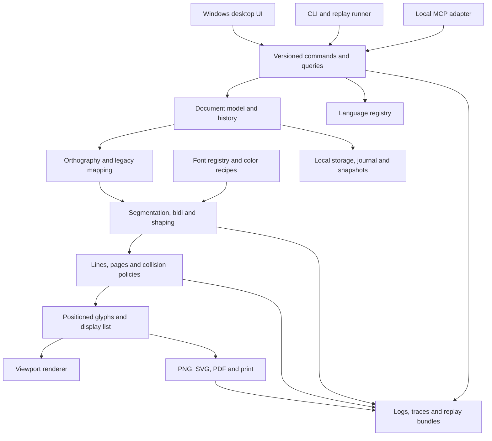

# Architecture and engineering decisions

Specification revision 0.5.0, 2026-10-22. M0 evidence tooling, M1 native laboratory, M2 authoring and M3 typesetting are implemented. See [M0](M0.md), [M1](M1.md), [M2](M2.md) and [M3](M3.md) for the supported scope; later sections describe the broader target architecture. The machine-readable [decision register](../data/decisions.json) records the adapter and persistence choices.

The working M1 core is Python plus pinned Qt 6.8.3. QTextDocument/QTextLayout own layout, native QTextEdit owns input and accessibility, and QGlyphRun/QRawFont share positioned glyphs between the color preview and headless PNG renderer. Process-private renamed font copies solve family-name collisions without modifying original bytes. The local API uses QLocalServer with current-user OS access, and the stdio MCP adapter forwards to that same session. This is an explicit replacement for the earlier provisional Rust/Tauri/Skia route, not evidence that route failed. M2 can continue this adapter; any later replacement must pass the same geometry, input, preservation, and accessibility gates.

M2's `AuthoringSession` is the single document writer above one `FrameSession`/QTextDocument per independent frame. Page placement composes existing native glyph geometry. UI/API edits share validation, revision checks, complete-state undo and durable recovery checkpoints. Native files embed M0 semantic runs plus versioned M2 frame/paragraph/character settings. Requested character spacing is stored separately from Qt's internal rounding. The M1 wrapper migrates into a frame without overwriting its source. Outline SVG uses the same positioned glyph paths with clipping baked into the geometry. M3 adds derived cross-frame flow; large-document incremental persistence remains future work.

M3's `TypesettingSession` keeps the same source documents and writer, with policy in native format 0.3.0. A cached `Composition` shapes coalesced native format ranges, selects Unicode/tailored breaks, positions equal-width story chains, then applies bounded vertical constraints. Source glyph clusters protect joins and marks. Preview, hit testing and PNG/SVG use that derived result; the native source editor remains the input authority. API 0.4.0 publishes 57 operations. Older schemas remain frozen, and migration preserves original files.

## 1. System boundary

Keep semantic editing, typography, persistence, and language data in a core that runs with or without the desktop window. The desktop, CLI, and MCP adapter share a command/query contract and observe the same revisioned results.



A layout result carries a document revision, layout generation, engine fingerprint, and asset hashes. Older worker results cannot overwrite a newer viewport. Export and automation can request a stable snapshot while the user continues editing.

## 2. Decision register

“Accepted” records direction established by the user or implementation evidence. “Proposed” remains future work. M1 pins and measures the native Qt adapter; its exact dependency versions and measurements are linked in the M1 guide.

| ID | Decision | Status and validation |
| --- | --- | --- |
| ADR-001 | Windows desktop, local files, offline core | Accepted by user |
| ADR-002 | Python/Qt native laboratory and shared session | Accepted for M1; replaces the unimplemented Rust/Tauri proposal |
| ADR-003 | Qt text engine and positioned QGlyphRun rendering | Accepted for M1; actual font and UI/headless parity evidence, with explicit engine/platform fingerprints |
| ADR-004 | Core-owned geometry and a shared display list | Accepted design constraint; adapters may differ, layout authority may not |
| ADR-005 | Versioned semantic text, explicit legacy mapping, file-hash font identity | Accepted data-preservation constraint |
| ADR-006 | Editable native color recipe plus portable color-font build output | Proposed delivery design; M4 proves supported formats/effects |
| ADR-007 | One local MCP adapter backed by the application API | Accepted control direction; transport and supported protocol revision chosen during implementation |
| ADR-008 | Directory-based working document with atomic checkpoints; portable bundle export | Proposed; M2 proves recovery and external-edit handling |
| ADR-009 | Single-writer core per document with revision-checked command queue | Proposed initial concurrency model; collaboration protocols deferred |

Tauri uses a Rust core process and WebView2 on Windows. Its process split makes it a plausible shell for a native core and web-based controls; it does not establish that a custom canvas editor will handle input or accessibility correctly. Those remain M1 gates. [Tauri process model](https://v2.tauri.app/concept/process-model/)

Candidate viewport implementation: native Skia generates cached visible-page tiles, transported as binary assets through a local application protocol. Draw caret/selection from core geometry and request only dirty tiles. Measure CPU copies, IPC overhead, DPI behavior, seams, and GPU resource recovery. Do not allocate one bitmap for an entire enormous page or send base64 page images on every keystroke. If this route fails the budgets, evaluate a native drawing surface before extending the shell. A CanvasKit adapter is another option, but would add a second renderer build to keep compatible; it is not the default assumption. [CanvasKit capabilities](https://skia.org/docs/user/modules/canvaskit/)

All build/runtime dependencies must be pinned after the spike, including native library revisions and feature flags. Record Unicode data, fonts, hinting policy, render backend, OS, and WebView versions in diagnostics. Deterministic geometry is required for a fixed engine profile; pixel-identical GPU output across machines is a separate, stronger claim we will not assume.

## 3. Document and language model

Proposed hierarchy: workspace → documents → sections → flow stories/blocks → typed inline runs. Pages contain frames that reference a flow story; page geometry is separate from text. Stable IDs identify documents, blocks, styles, stories, frames, and language entities. Selection anchors reference semantic positions with affinity and a document revision.

Three inline representations are needed during migration:

| Representation | Meaning | Required metadata |
| --- | --- | --- |
| Unicode text | Ordinary text, including English, IPA, and other supported scripts | Language, direction, style, normalization policy |
| Script-symbol sequence | Canonical script units independent of a particular font | Stable symbol IDs, orthography revision, case/form information, source links |
| Preserved legacy span | Original character sequence whose interpretation depends on a legacy font/profile | Original codes, exact source/font identity, mapping profile, unresolved positions |

Do not make rendered glyph IDs the persistent text. Glyph IDs belong to one font revision. Do not force an early Private Use Area allocation to become the permanent language model. The M0 mapping schema should permit a later Unicode/PUA interchange profile without rewriting entity identities.

Normal text can remain Unicode strings. Script-symbol sequences project through a chosen profile into shaping input; every projection retains an inverse source map. Many-to-one and one-to-many transliteration relationships must be represented explicitly. Preserve unresolved legacy spans losslessly rather than replacing them with question marks.

Offsets have declared units. API ranges carry a revision and semantic position type; adapters maintain conversions among UTF-8 bytes, UTF-16 code units, Unicode scalars, editing boundaries, and shaping clusters. UI hit-testing does not infer source positions from pixel width. Keyboard deletion and caret movement use editing boundaries, which are not necessarily the same as shaping clusters. Ligature carets and bidirectional affinity need explicit behavior.

The language registry has independent entities for languages, scripts, symbols, orthographies, input maps, transliteration rules, lexemes, senses, morphemes, grammatical features, analyses, examples, and attestations. A script letter is not automatically a phoneme or a lexeme. Use internal IDs; store standards-based language/script tags only where valid. Do not invent registered ISO or OpenType tags for the conlang.

Normalization, case conversion, collation, spellchecking, and hyphenation are language/profile-dependent operations. Legacy spans are never silently normalized or run through English case rules. Search offers explicit source, normalized, and transliteration modes; ambiguous transliteration does not promise a reversible round trip. Spellcheck remains off for a language until an appropriate lexicon/rule set exists.

## 4. Font identity, import, and shaping

Font identity consists of content hash plus face index and relevant instance coordinates. Display names are labels. A registry records source path, coverage, font tables, metrics, family aliases, warnings, and licensing/embedding metadata. Missing fonts remain visible with a diagnostic placeholder; substitution is an explicit choice with a reflow preview.

Legacy import records the original file hash, original character sequence, font/style runs, selected mapping profile, and any unresolved ambiguities. DOCX import should examine run styles and font references, not just concatenate text. Scanned images and native design files remain visual/source references until a format-specific importer is validated.

Pipeline:

1. Resolve styles, language/orthography profiles, source maps, direction, and font fallbacks.
2. Determine editing boundaries, bidi levels, and line-break opportunities using a pinned Unicode implementation plus declared tailoring. Unicode publishes distinct algorithms for [segmentation](https://www.unicode.org/reports/tr29/), [bidirectional order](https://www.unicode.org/reports/tr9/), and [line-break opportunities](https://www.unicode.org/reports/tr14/). Actual width-based break selection is the editor's responsibility.
3. Shape runs with explicit font, language, script, direction, features, size, and variation settings. HarfBuzz produces positioned glyphs and exposes cluster information; this does not supply document pagination or editing behavior. [HarfBuzz shaping](https://harfbuzz.github.io/what-does-harfbuzz-do.html)
4. Choose line breaks against the frame width and shaping constraints. Reshape affected boundaries when required, then perform line-level bidi ordering and alignment. HarfBuzz marks boundaries that need reshaping if broken. [HarfBuzz getting started](https://harfbuzz.github.io/getting-started.html)
5. Position lines, apply the selected collision policy, paginate, and emit layout plus source/caret maps.
6. Paint positioned glyphs and effects; use the same positions for hit-testing, diagnostics, and export.

Never add a second manual kern-table pass on top of shaped positions. The selected fonts contain both GPOS and legacy kern tables. Test feature-on/off output and the engine's chosen path. Tracking and user adjustments are separate, recorded operations applied only at allowed boundaries; they must not split attached marks or connected shaping units.

For the three legacy color layers, use Thimfora 79 as the master shaping font. Map each master glyph to the corresponding layer glyph through a validated recipe. Reuse master advances, offsets, cluster maps, and baselines for all layers. Do not align layers by bounding-box corners or assume that equal side bearings are required. The checked audit finds matching advances and positioning tables but differing interior-layer side bearings; visual registration still needs proof against the source art.

## 5. Page geometry and layout

Proposed storage units: checked integer micro-points (one millionth of a typographic point), with rational unit conversion at input/output boundaries. A point is 1/72 inch. Encode large integer quantities safely across the Rust/JavaScript boundary and validate arithmetic/coordinate limits. Convert to local-origin floating-point coordinates for rendering to avoid losing precision on very large pages.

Store page width and height independently from zoom, device pixels, raster export DPI, and printer capabilities. Pages may use a shared template or overrides. Frames have explicit bounds, padding, columns, flow order, exclusion regions, and overflow policy. Reusable page furniture, interlinear blocks, tables, images, and anchored annotations can extend the block model later.

Typography controls include font size and features, kerning, tracking, word spacing, baseline shift, first-line indent, tabs, line height, leading distribution, paragraph spacing, alignment/justification, break permissions, keep policies, and baseline grid snapping. Separate user-authored values from computed values. The inspector must show both, with inherited style provenance.

Cache by semantic inputs: text and profile revisions, font hashes, style, frame width, and engine profile. Dirty propagation begins at the edited block; pagination continues downstream until state converges with cached results. Width changes can invalidate an entire story. Cancellation and generation checks prevent obsolete results from entering the viewport.

## 6. Collision policies

Four distinct geometries matter:

- **Advance geometry:** logical spacing from shaping, used for flow and caret behavior.
- **Ink geometry:** actual glyph contours, including overhangs and marks.
- **Stroke geometry:** ink expanded by explicit strokes.
- **Effect geometry:** shadow/glow/bevel coverage under a documented finite extent/alpha threshold.

An overlap is not automatically an error. Connected writing, diacritics, ligatures, and the layers of one color glyph intentionally overlap. Collision groups and allowed-overlap rules exclude those relationships. Report inter-glyph, inter-line, frame, page-edge, and anchored-object collisions separately.

Initial algorithm: bounding boxes for broad-phase candidates, then tighter contour or conservative coverage tests for candidates. Geometry is cached in font space and transformed consistently. Report the method and tolerance; a low-resolution raster approximation must not be described as exact contour clearance.

Policies: **allow**, **warn**, **expand leading**, **adjust permitted spacing**, or **reflow within constraints**. The user can protect manual placements and set minimum clearances, maximum displacement, fixed baselines, and page/paragraph constraints. Fixed line height plus mandatory clearance can be infeasible; return that conflict instead of silently violating either setting.

For a simple horizontal pair of lines, a conservative baseline separation is the maximum of requested leading and the previous line's descent plus the next line's ascent plus required clearance, using the selected ink/effect envelopes. This is a broad bound; a tighter clearance calculation can inspect only horizontally overlapping geometry. Include baseline shifts and transformed effects in those envelopes.

Repairs follow an ordered policy, use deterministic tie-breaking, and have bounded iterations. Recompute affected breaks/pages after a repair, detect cycles, and surface unresolved constraints. Never shrink fonts, alter wording, deform letters, or modify source fonts automatically to satisfy a collision. Keep intentional optical corrections in versioned styles or explicit overrides.

Each finding includes involved source ranges, glyph/line IDs, geometry, clearance, tolerance, policy, attempted changes, and the reason it remains or was resolved. This is inspectable through UI and API.

## 7. Color font and export design

A color recipe contains source font hashes, a master-to-layer glyph map, coordinate transforms, paint order, palette entries, paint/effect parameters, bounds policy, and a recipe schema/version. The original font files are immutable inputs. Each generated font is a new artifact with its own hash and build manifest.

Portable output starts with COLR/CPAL: version 0 supports layered color glyphs; version 1 adds paint graphs including gradients, transforms, and compositing. Layout precedes the color presentation. Use the format's actual feature set when compiling a recipe. [OpenType COLR specification](https://learn.microsoft.com/en-us/typography/opentype/spec/colr)

Do not assume Photoshop bevel/glow styles translate directly into a COLR paint graph. Native editor effects may need approximation, vector expansion, or raster output in other applications. Produce a capability report by target format and renderer. Evaluate SVG-in-OpenType or bitmap color tables only for a concrete compatibility need; “color TTF” alone is not a guarantee of identical appearance everywhere. A pinned fontTools-based build pipeline is a candidate to evaluate in M4.

SVG/PDF/PNG exporters consume the canonical display list. The export preflight chooses between native text, positioned outlines, and explicit raster effect layers, with selectable resolution and background. Skia documents PDF effect limitations, including cases that drop effects or lose text-as-text; the export adapter must test or replace these paths rather than blindly trusting a successful save. [Skia PDF backend limitations](https://skia.org/docs/user/sample/pdf/)

Searchable text requires a valid semantic mapping, not the legacy Latin codes merely copied into a PDF. Keep a separate copy/search representation, ToUnicode/ActualText support where feasible, and a declared fallback when meaningful extraction is unavailable. Preserve document text regardless of export mode. Verify dimensions, transparency, clipping, colors, extraction, and effect appearance in an independent reader.

## 8. APIs and MCP controls

Start with a typed core API, generated JSON schemas, a machine-readable capability list, and a versioned command registry. UI, CLI, and MCP call this registry. Do not make automation depend on clicking particular pixel coordinates or reaching into private UI state.

| Area | Initial command/query families |
| --- | --- |
| Session | capabilities, attach live session, health, list documents, job status/cancel |
| Document | create/open, read semantic tree, apply transaction, undo/redo, save/checkpoint, revision diff |
| Editing | read/set selection, insert/delete/replace, apply style, search, input-symbol insertion |
| Pages | get/set dimensions, margins and frames, inspect overflow, paginate |
| Fonts | register/list/inspect, coverage, resolve identity, inspect mapping, compare metrics |
| Typography | inspect shaping, inspect line breaks, inspect bounds, collision report, preview policy changes |
| Color | inspect/validate recipe, preview palette/layers, build derived font as a cancellable job |
| Rendering | render page/region, screenshot with optional overlays, export, compare render artifacts |
| Diagnostics | query/tail logs, trace operation, capture replay bundle, replay fixture, inspect performance |
| Language | query/edit versioned inventory, lexicon, rules, analyses and source links as M5 arrives |

Mutations carry `requestId`, `documentId`, `expectedRevision`, and a scoped idempotency key. A transaction is validated and applied atomically; its result includes the new revision, undo group, affected entities, warnings, and trace ID. A repeated idempotent request returns the original result; reusing its key with different content is an error. Stale revisions return a conflict without applying edits. Persist enough deduplication state to prevent a retry after reconnect from applying a durable edit twice.

Queries are revision-bound. A render result specifies the document revision, layout generation, dimensions, asset references, and any pending/partial state. Heavy outputs use local artifact references and pagination rather than overflowing tool responses. Long jobs expose progress and cancellation; cancellation does not leave partially committed document edits.

Use one local MCP adapter initially. The protocol provides stdio and Streamable HTTP transport bindings; choose a supported protocol revision explicitly and test interoperability with the intended client. [MCP transport specification](https://modelcontextprotocol.io/specification/latest/basic/transports)

Proposed live-session bridge: the MCP subprocess connects to the running app through an authenticated, current-user-scoped local channel, such as a Windows named pipe. Headless sessions are explicit alternatives and return their own session IDs. This avoids accidentally editing a second invisible copy of an open document. No network listener is required for the initial local workflow.

Scope file operations to selected workspaces, expose typed operations instead of a general shell tool, and keep external publishing separate from local editing. Agent edits appear in the normal undo/history UI. MCP stdout carries protocol messages only; application logs use stderr and structured log files. Add other MCP servers only when a workflow needs an external application or data source.

## 9. Observability and troubleshooting

Provide an in-app diagnostics panel and the same information through CLI/MCP. A developer launch command captures UI console errors, unhandled rejections, core errors/panics, renderer and font-loader errors, worker exits, importer/exporter messages, and child-process stdout/stderr. Build output and exit codes are retained with the run ID. A failed process is visible even if its log stream stops.

Each structured event has timestamp, level, subsystem, session/run ID, operation/trace ID, document/revision, layout generation, engine build, diagnostic code, message, and optional geometry/source links. Include durations, queue depth, cache hits, memory, and cancellation reasons where useful. Use bounded rotating logs and counters for dropped events so a logging flood cannot freeze the editor.

Inspector overlays: frame/margin bounds, baselines, ascent/descent, advance/ink/effect bounds, cluster/source ranges, glyph origins, break opportunities and chosen breaks, collision candidates, clipping, and fallback fonts. Selecting a diagnostic focuses the relevant glyph or line and its cause.

A replay bundle includes a minimized document or explicit source snapshot, ordered command sequence, selected logs, error stacks, engine and OS/runtime versions, font/mapping/recipe hashes, layout dumps, reference render, and reproduction instructions. Asset inclusion is explicit; otherwise the runner reports missing hashes. Local diagnostics are directly inspectable during development, while uploads and repository inclusion remain deliberate operations. Add a reduced regression fixture after a bug is understood.

## 10. Persistence, revisioning, and recovery

Proposed working format is a directory with a manifest, immutable content-addressed snapshots/assets, an append-only operation journal, and optional disposable caches. A portable bundle packages the required files for transfer; do not rewrite a large archive on every keystroke. The file extension and exact schema remain M0 decisions.

Record `schemaVersion`, document ID/revision, orthography/language revisions, font hashes, recipe versions, layout profile, and required application capabilities. Do not store layout caches as canonical content. A preview remains useful when an asset is absent but is never the editable source of truth.

One writer serializes transactions. Acknowledge durability separately from immediate UI acceptance: journal accepted edits, flush at a documented cadence, and expose the last durable revision. Explicit Save must durably commit its target revision. Crash recovery promises the last durable state, with any recovery window visible; it cannot promise survival of arbitrary unflushed keystrokes.

Save through a same-volume temporary file, flush, validate checksum/schema, then replace the checkpoint manifest using an appropriate Windows atomic-replacement primitive. Retain the previous valid manifest and journal. Detect truncated/corrupt journal tails, disk-full and permission errors, and external modifications. Do not overwrite an externally changed document without surfacing a conflict.

Migrations are explicit, versioned, and tested against fixtures. Preserve a pre-migration snapshot and original metadata; unsupported newer schemas open read-only where possible. Keep source history, user undo history, named document revisions, and independent backups conceptually separate. Indexed language/search data may use SQLite later as a rebuildable index rather than the only portable copy of language records.

## 11. First implementation layout

M1 implementation lives in `vayrshemon/`: session, fonts, layout, desktop, API, MCP, diagnostics, and benchmark modules. `tools/run_lab.py` is the absolute-path MCP entry point. The following earlier Rust workspace layout remains a historical proposal, not the implemented tree:

```text
apps/desktop/             Windows shell, controls, input and accessibility adapters
crates/document/          Semantic model, commands, history, persistence
crates/typography/        Mapping, shaping, line/page layout, collisions
crates/render/            Display list, preview and export adapters
crates/language/          Versioned orthography and later language entities
crates/cli/               Headless inspection, replay, export, recovery
packages/contracts/      API schemas and generated client types
packages/mcp/            MCP adapter to live or headless sessions
schemas/                 Document, recipe, mapping and language schemas
tools/                   Font inspection/build and fixture preparation
tests/fixtures/           Public minimal specimens and asset references
docs/                    Plan, decisions, format and workflow documentation
Inputs/                  Ignored original archive
```

Keep the first workspace small: document/typography core, a lab window, a CLI, and the control adapter. Split modules only when their contracts are clear. Every added subsystem must expose both operations and failure evidence before it becomes a dependency of normal authoring.

M5 is implemented in `language_session.py`, `language.py`, `language_contracts.py`, `language_api.py` and `language_window.py`. It extends M4 without changing composition. Native state embeds immutable content-addressed records, a revision graph and explicit corpus/document anchors. Language exports contain one selected portable dataset; native files retain revision history. `archive_language.py` is an opt-in, hash-checked local importer. `language_publication.py` publishes the same selected data as escaped printable HTML. The existing command boundary supplies undo, revision guards, recovery and trace logs. Exact numeric computation uses Python `Fraction`; no floating-point conversion is involved. Source text and typography are never rewritten by language adoption.
